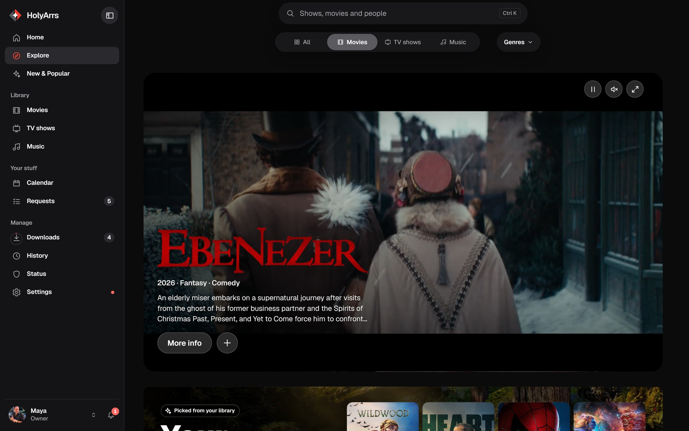
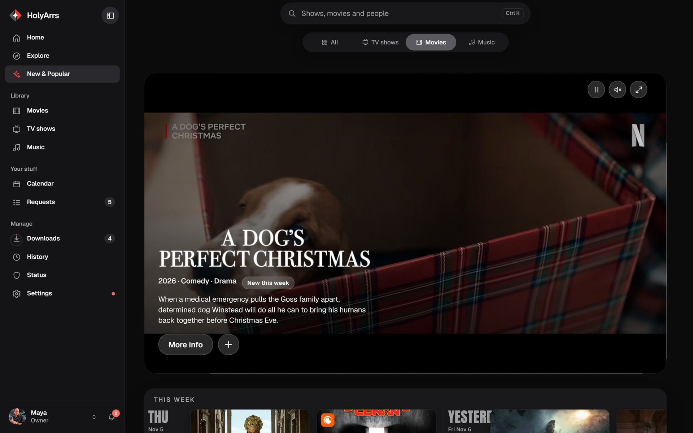
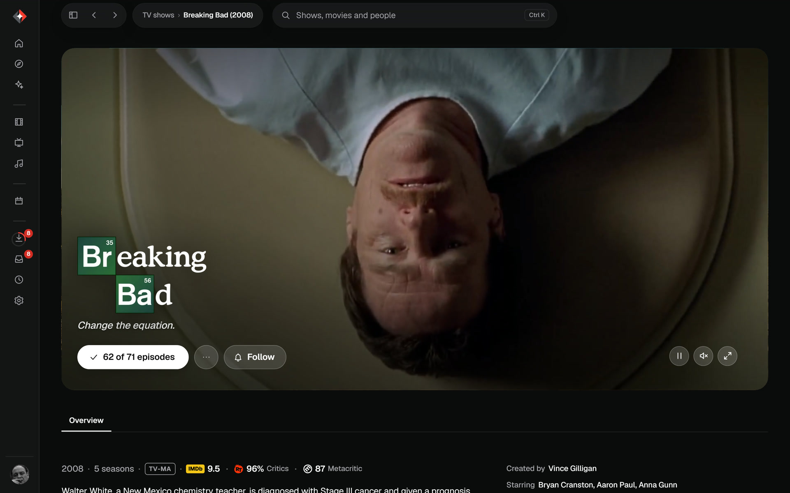
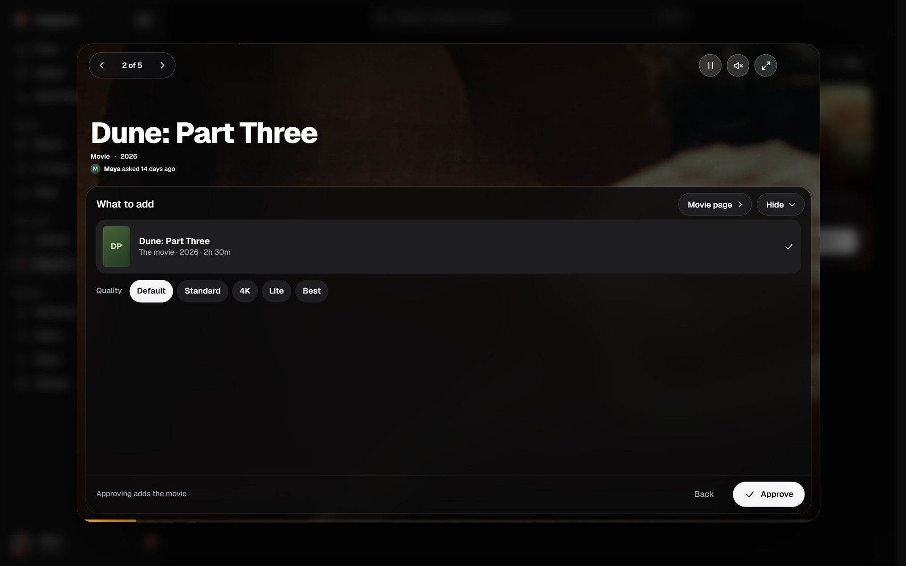
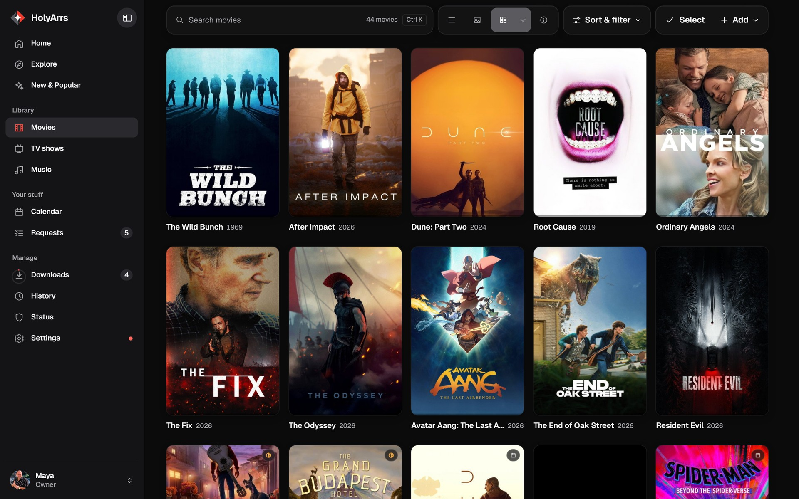
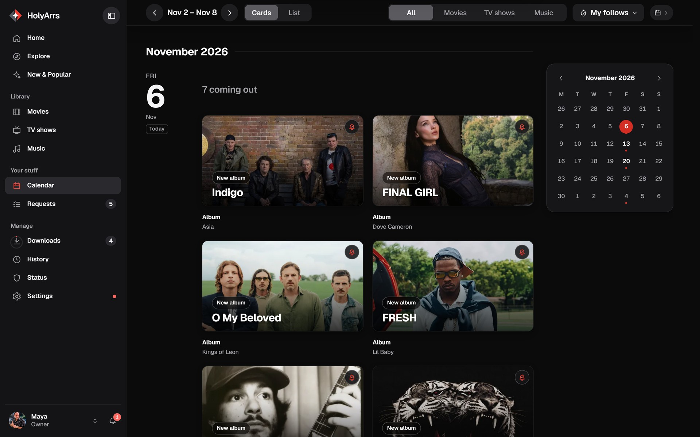

<p align="center">
  <picture>
    <source media="(prefers-color-scheme: light)" srcset=".github/banner-light.gif">
    
  </picture>
</p>

<p align="center"><a href="https://holyarrs.com"><picture><source media="(prefers-color-scheme: dark)" srcset="https://raw.githubusercontent.com/HolyArrs/.github/main/profile/btn-site-dark.png"></picture></a>&nbsp;<a href="https://holyarrs.com/roadmap/"><picture><source media="(prefers-color-scheme: dark)" srcset="https://raw.githubusercontent.com/HolyArrs/.github/main/profile/btn-roadmap-dark.png"></picture></a>&nbsp;<a href="https://holyarrs.com/whats-new/"><picture><source media="(prefers-color-scheme: dark)" srcset="https://raw.githubusercontent.com/HolyArrs/.github/main/profile/btn-news-dark.png"></picture></a>&nbsp;<a href="https://community.holyarrs.com"><picture><source media="(prefers-color-scheme: dark)" srcset="https://raw.githubusercontent.com/HolyArrs/.github/main/profile/btn-community-dark.png"></picture></a></p>

<p align="center">

<p align="center">
  <a href="https://unraid.net/community/apps?q=holyarrs"></a>
  <a href="https://hub.docker.com/r/holyarrs/holyarrs/tags"></a>
  <a href="https://hub.docker.com/r/holyarrs/holyarrs"></a>
  <a href="LICENSE"></a>
</p>

> [!TIP]
> Be with us!
>
> | | |
> |:--|:--|
> | <a href="https://discord.com/invite/mthsvesKpC"></a> | Get help fast and hang out on [Discord](https://discord.com/invite/mthsvesKpC) |
> | <a href="https://reddit.com/r/HolyArrs"></a> | Share ideas and vote on [r/HolyArrs](https://reddit.com/r/HolyArrs) |
> | <a href="https://x.com/CoderLuii"></a> | Sneak peeks on [X](https://x.com/CoderLuii) |
> | <a href="https://github.com/CoderLuii"></a> | More projects on [GitHub](https://github.com/CoderLuii) |

<h3 align="center">HolyArrs, ready for your Unraid server.</h3>

<p align="center">The Community Apps template for <a href="https://github.com/HolyArrs/HolyArrs"><b>HolyArrs</b></a>, one self-hosted app for your shows, movies and music.<br>Browse like a streaming app, ask for what you want, and it handles the rest.</p>

<p align="center"><b>About 16.1 MB to download · about 95 MiB of RAM idle on a fresh install · one container on port 6262</b><br><sub>It does the job of Sonarr, Radarr, Lidarr, Bazarr, Prowlarr and Seerr.</sub></p>

<p align="center"><a href="#install">Install</a> · <a href="#look">A look inside</a> · <a href="#settings">Settings</a> · <a href="#tips">Unraid tips</a> · <a href="#help">Help</a></p>

<p align="center">
  <picture><source media="(prefers-color-scheme: dark)" srcset="https://raw.githubusercontent.com/HolyArrs/.github/main/profile/hero-dark.webp"></picture>
</p>

<a id="install"></a>
## 📦 Install

1. On your Unraid server, open the **Apps** tab.
2. Search for **HolyArrs** and press **Install**.
3. Check the **Config** path (see [Unraid tips](#tips)), add your library and download folders if you want, and press **Apply**.
4. Open `http://<your-server>:6262` and follow the setup wizard.

<details>
<summary><b>Not in your Apps tab yet?</b></summary>

Add the template by hand: in **Docker → Add Container**, paste this into **Template**, then press **Apply**:

```text
https://raw.githubusercontent.com/HolyArrs/HolyArrs-Templates/main/templates/holyarrs.xml
```

</details>

> [!NOTE]
> HolyArrs is in beta. Run it next to your current setup until it has proven itself on yours. It can import your Sonarr and Radarr libraries, so nothing has to move.

<a id="look"></a>
## 🎬 A look inside

<table>
<tr>
<td width="50%"><br><sub><b>Explore.</b> Top 10s, trailers and what's coming soon.</sub></td>
<td width="50%"><br><sub><b>New & Popular.</b> What everyone is watching right now.</sub></td>
</tr>
<tr>
<td><br><sub><b>Title pages.</b> Seasons, cast, trailers and one-tap requests.</sub></td>
<td><br><sub><b>Requests.</b> Family and friends ask, you approve or let it run.</sub></td>
</tr>
<tr>
<td><br><sub><b>Library.</b> Everything you have, with its quality and files.</sub></td>
<td><br><sub><b>Calendar.</b> Upcoming episodes and releases.</sub></td>
</tr>
</table>

<a id="settings"></a>
## ⚙️ Settings

| Setting | In the container | Default | What it's for |
|---|---|---|---|
| Web port | `6262` | `6262` | The web interface |
| Config | `/config` | `/mnt/cache/appdata/holyarrs` | Database, keys and settings. Keep it on a pool path, see below |
| Movies | `/movies` | | Optional. Your movie library |
| Shows | `/tv` | | Optional. Your shows library |
| Music | `/music` | | Optional. Your music library |
| Downloads | `/downloads` | | Optional. Your downloader's download folder |
| Allowed host names | `HOLYARRS_ALLOWED_HOSTS` | | Optional. Names you open HolyArrs by besides its IP, for example `tower.local` |
| PUID / PGID | | `99` / `100` | The user and group HolyArrs runs as (advanced) |
| UMASK | | `022` | `002` lets the group write (advanced) |
| TZ | | `America/New_York` | Your time zone (advanced) |

<a id="tips"></a>
## 💡 Unraid tips

> [!IMPORTANT]
> **Keep `/config` on a direct pool path**, such as `/mnt/cache/appdata/holyarrs`, not `/mnt/user/...`. Also keep the appdata share on that pool: **Primary storage: Cache, Secondary storage: None**. If the mover can move appdata to the array, `/config` ends up empty and HolyArrs starts without its key and database.

- **Hardlinks:** map one share that holds both your downloads and your library folders, so finished downloads are linked instead of copied.
- **You'll need** a downloader such as qBittorrent or SABnzbd, and Plex, Jellyfin or Emby to watch.
- **Backups:** your Appdata Backup plugin picks up `/config` like any other app.

<a id="help"></a>
## 🆘 Help

- **Unraid questions:** the [support thread](https://forums.unraid.net/topic/201254-support-holyarrs-netflix-style-app-for-shows-movies-and-music-the-whole-arr-stack-in-one-15-mb-container/) on the Unraid forum
- **Anything else:** the [HolyArrs Community](https://community.holyarrs.com/c/help/6) or [Discord](https://discord.com/invite/mthsvesKpC)
- **Setup guide:** [docs.holyarrs.com/start/install](https://docs.holyarrs.com/start/install/)
- **Bugs in HolyArrs itself:** [the main repo](https://github.com/HolyArrs/HolyArrs/issues)
- **Problems with this template:** [open an issue here](https://github.com/HolyArrs/HolyArrs-Templates/issues)

<details>
<summary><b>What's in here</b></summary>

```
templates/holyarrs.xml   the Unraid template
ca_profile.xml           the maintainer profile Community Apps shows
icons/                   the app icon
screenshots/             the screenshots on the app's Community Apps page
```

</details>


## Licence

[AGPL-3.0](LICENSE), same as HolyArrs.
